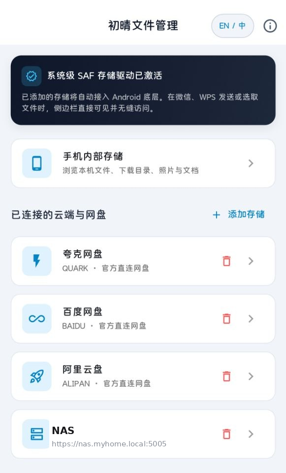
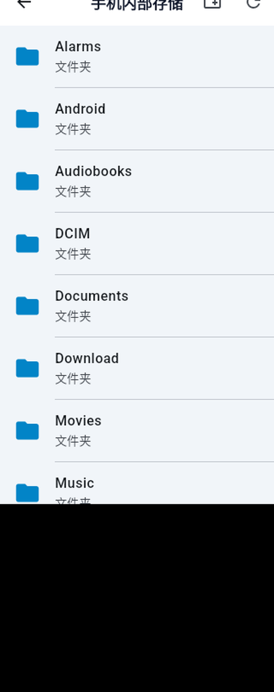

# FineFiles (初晴文件)

[English Version](#english-version) | [中文版本](#中文版本)

---

## 中文版本

**FineFiles (初晴文件)** 是一款轻量、现代且纯粹的 Android 存储管理与云原生聚合工具。

不仅提供了丝滑的本地存储浏览与管理体验，还原生深度集成了 Android **存储访问框架 (SAF / DocumentsProvider)**。您可以将自建私网 WebDAV、NAS 存储或主流公有云盘直接挂载为系统原生存储源，让手机自带的“系统文件管理器”及所有第三方应用无缝读写云端资产。

---

### 📸 界面预览 (Screenshots)

<p align="center">
  
  &nbsp;&nbsp;&nbsp;&nbsp;
  
</p>

---

### ✨ 核心特性

- 🌐 **系统级存储提供者 (DocumentsProvider / SAF)**：
  - 核心存储源直接挂载至 Android 原生文件选择器与系统文件侧边栏；
  - 微信、WPS、MX Player 等任意第三方 App 可直接打开或保存文件至远端 NAS / WebDAV，无需先手动下载到本地。
- ☁️ **多存储协议与云端聚合**：
  - **WebDAV / NAS 深度支持**：支持自建 WebDAV、群晖/威联通/TrueNAS、AList 等私有存储，自签证书支持，局域网与外网高速同步；
  - **主流云盘扩展**：支持主流云存储挂载与跨盘高速互传。
- 🎨 **现代化极简设计与双语体验**：
  - 遵循 Material You (M3) 设计语言，界面纯粹克制，零广告、零无用流氓权限；
  - 原生全流程支持 **简体中文** 与 **English** 双语实时无缝自适应。
- ⚡ **本地文件管理器全功能**：
  - 深度访问内部存储、下载目录、分类浏览（图片、视频、音频、文档、安装包）；
  - 支持多选批量复制、移动、重命名、分享与快捷调用系统默认应用。

---

### 📥 下载安装

- 🌐 **GitHub 官方渠道**：前往 [Releases](https://github.com/sbitoh/finefiles/releases) 页面下载最新 APK 安装包。
- 📦 **本地离线包**：最新稳定编译版已命名为 `finefiles-v1.0.0.apk`。

---

### 🛠️ 技术栈与编译构建

- **Framework**: Flutter 3.x (Dart 3.x)
- **Native Android**: Kotlin + DocumentsProvider + AndroidX DocumentsUI
- **协议与解析**: WebDAV (PROPFIND / MKCOL / MOVE / COPY / PUT / GET), HTTP/2

#### 本地构建步骤

```bash
# 1. 克隆代码库
git clone https://github.com/sbitoh/finefiles.git
cd finefiles

# 2. 获取依赖
flutter pub get

# 3. 编译正式版 APK
flutter build apk --release
```
编译生成的产物位于：`build/app/outputs/flutter-apk/app-release.apk`。

---

### 📄 开源许可

本项目采用 [Apache-2.0 License](LICENSE) 协议开源。欢迎提交 Issue 与 Pull Request！

---

## English Version

**FineFiles** is a modern, lightweight, and versatile file manager for Android, featuring first-class **Android Storage Access Framework (SAF / DocumentsProvider)** integration.

In addition to sleek local file navigation, FineFiles mounts your private WebDAV, NAS, and cloud drives directly into the Android system document drawer, enabling third-party apps to access remote assets natively without downloading them first.

---

### 📸 Screenshots

<p align="center">
  
  &nbsp;&nbsp;&nbsp;&nbsp;
  
</p>

---

### ✨ Features

- 🌐 **Native Android DocumentsProvider (SAF)**:
  - Mounts network and cloud storage directly into the Android system file picker;
  - Third-party apps (e.g. office suites, media players) can read/write remote cloud files natively.
- ☁️ **Multi-Protocol & Cloud Aggregation**:
  - **WebDAV & NAS**: Tailored for Synology, QNAP, TrueNAS, and AList; robust self-signed SSL/TLS support;
  - **Cloud Drives**: Unified management and cross-cloud operations.
- 🎨 **Minimalist Material Design & Dual Language**:
  - Pure Material 3 experience with clean, intuitive layouts; zero bloat, zero tracking;
  - Fully bilingual with complete **English** and **Simplified Chinese** localization.
- ⚡ **Full-Featured Local Management**:
  - Full internal storage traversal, quick category views, and batch operations (copy, move, delete, share, rename).

---

### 📥 Download

- 🌐 **GitHub Releases**: Download the latest release from the official [Releases](https://github.com/sbitoh/finefiles/releases) page.
- 📦 **Direct Package**: Stable build asset: `finefiles-v1.0.0.apk`.

---

### 🛠️ Build from Source

```bash
git clone https://github.com/sbitoh/finefiles.git
cd finefiles
flutter pub get
flutter build apk --release
```
Output artifact: `build/app/outputs/flutter-apk/app-release.apk`.

---

### 📄 License

Licensed under the [Apache-2.0 License](LICENSE). Contributions, issues, and PRs are welcome!
